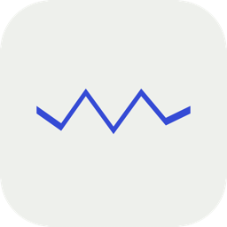

<p align="center">
  
</p>

<h1 align="center">LocalFlow</h1>

<p align="center">
  <strong>Voice-to-text and Mac control, on-device or with your own API key.</strong><br>
  Speak naturally anywhere you type. Choose Apple Speech, local models, or a cloud provider.
</p>

<p align="center">
  <a href="https://apple.com/macos"></a>
  <a href="https://developer.apple.com/xcode/"></a>
  <a href="https://github.com/AnuragTummapudi/Localflow/actions/workflows/ci.yml"></a>
  <a href="#"></a>
  <a href="#privacy"></a>
  <a href="https://github.com/AnuragTummapudi/Localflow/releases/latest"></a>
</p>

<p align="center">
  <a href="#key-features">Key Features</a> •
  <a href="#download--installation">Download</a> •
  <a href="#how-to-use">How to Use</a> •
  <a href="#voice-commands">Voice Commands</a> •
  <a href="#smart-polish--prompt-engineering">Smart Polish</a> •
  <a href="#building-from-source">Build from Source</a> •
  <a href="#privacy--security">Privacy</a>
</p>

---

<p align="center">
  
</p>

> **Choose where your words go.** Use LocalFlow on your Mac without API usage fees, or bring your own key for cloud dictation and Smart Polish.

---

## ⚡ Key Features

- **🎙️ Three dictation modes**: Apple Speech, local Parakeet / Whisper, or cloud transcription with your Groq, OpenAI, or Gemini API key.
- **⌨️ Instant Text Insertion**: Hold **Fn** or **Right Option** to dictate, then release to insert text into any focused text box, IDE, browser, or terminal without stealing application focus.
- **🙌 Hands-Free Toggle**: Double-tap your trigger key to lock dictation hands-free for continuous talking, and single-tap to stop.
- **🧠 Smart Polish**: Rewrite selected text with **Option + 1** using Apple Intelligence or your Groq, OpenAI, Claude, or Gemini key.
- **🛠️ Prompt Engineering**: Convert spoken engineering intent into high-leverage prompts with **Option + 2** (role, objective, context, instructions).
- **🎵 Native Spotify Integration**: Say *"play Midnight City by M83 on Spotify"* or *"play Bohemian Rhapsody"* to instantly open Spotify with the song searched and results displayed. Also controls playback (`pause`, `resume`, `skip`, `previous`) locally.
- **🖥️ System Voice Commands**: Control your Mac by voice: mute/unmute audio, sleep display, lock the screen, launch apps, or search directly on Google, YouTube, and GitHub.
- **📝 App-Aware Smart Formatting**: Automatically adapts formatting for Slack, Gmail, Terminal, and code editors while removing spoken filler words and false starts.

---

## 📥 Download & Installation

### Option 1: Direct Download (.dmg)

1. Download the latest Universal build: **[LocalFlow.dmg](https://github.com/AnuragTummapudi/Localflow/releases/latest)** from GitHub Releases
2. Open `LocalFlow.dmg` and drag **LocalFlow.app** to your **Applications** folder.
3. Launch **LocalFlow** from Applications or Spotlight.

### Choose your processing mode

Onboarding and **Settings → General → Dictation & Smart Polish** offer:

1. **Apple Speech** — built-in on-device transcription on macOS 26+; may require a one-time language asset download.
2. **Local models** — Parakeet on Apple Silicon or Whisper, downloaded once and used locally.
3. **Your API key** — Groq (`whisper-large-v3-turbo`), OpenAI (`gpt-transcribe`), or Gemini (`gemini-3.5-flash-lite`) for dictation.

Smart Polish has an independent provider choice: Apple Intelligence, Groq, OpenAI, Claude, or Gemini. Claude is offered for text polishing only. Save the required keys, optionally check their connection, acknowledge cloud processing, then choose **Apply & prepare** (or **Finish setup**). Cloud usage requires internet and a provider account with model access and sufficient quota.

Cloud recordings are converted to 16 kHz mono before upload and limited to about six minutes; use local processing for longer recordings. Smart Polish accepts up to 6,000 characters and keeps existing output validation and selection-change protection. Option + 2 Prompt Engineer remains on-device.

Provider API references: [OpenAI transcription](https://developers.openai.com/api/docs/guides/speech-to-text), [Groq transcription](https://console.groq.com/docs/speech-to-text), [Gemini content generation](https://ai.google.dev/api/generate-content), [Claude Messages](https://platform.claude.com/docs/en/api/messages/create).

### Required Permissions

LocalFlow requires two standard macOS system permissions for audio capture and text insertion:

| Permission | Purpose | Why It's Needed |
|---|---|---|
| **🎤 Microphone** | Voice capture | Listens to your voice **only** while you hold your selected dictation key or while hands-free mode is active. |
| **♿ Accessibility** | Text insertion | Inserts transcribed text directly into whatever application you are currently typing in. |

*Grant permissions when prompted or via **System Settings → Privacy & Security**.*

---

## 🚀 How to Use

### 1. Push-to-Talk Dictation (Default)
- **Press & Hold** <kbd>Fn</kbd> (or <kbd>Right Option</kbd>, customizable in Settings).
- Speak your thought.
- **Release** the key — your text is transcribed and typed instantly into the active text field.

### 2. Hands-Free Dictation
- **Double-tap** <kbd>Fn</kbd> (or <kbd>Right Option</kbd>).
- The pill overlay locks into active recording mode.
- Speak freely for long-form thoughts, notes, or brainstorming.
- Tap the trigger key once to finish and insert.

### 3. Smart Polish & Prompt Engineering
- **Select any text** in your editor or browser.
- Press <kbd>⌥ Option</kbd> + <kbd>1</kbd>: Polishes the selection into clean, concise prose using the Smart Polish provider you selected.
- Press <kbd>⌥ Option</kbd> + <kbd>2</kbd>: Rewrites rough notes into a structured developer prompt with Role, Objective, and Constraints.

---

## 🎙️ Voice Commands

LocalFlow understands natural commands out of the box. Simply speak the command phrase while holding your dictation key:

### 🎵 Spotify & Media

| Spoken Phrase | Action | Behavior |
|---|---|---|
| `play [song] on Spotify` | Search & Show Results | Opens the Spotify desktop app with the query filled into search and results immediately shown. |
| `play [song]` | Local Search | Directly opens search in Spotify when the desktop app is installed on this Mac. |
| `open [query] in Spotify` | In-App Search | Opens native Spotify search results for the given artist, album, or track. |
| `pause Spotify` | Playback Control | Pauses the Spotify player using local macOS AppleScript. |
| `resume Spotify` / `play Spotify` | Playback Control | Resumes Spotify playback locally. |
| `next Spotify track` / `skip Spotify track` | Track Navigation | Skips to the next song in your queue. |
| `previous Spotify track` | Track Navigation | Navigates to the previous track. |

### 🖥️ Mac & Workspace Control

| Spoken Phrase | Action |
|---|---|
| `mute` / `unmute` | Toggles macOS system audio output mute. |
| `sleep display` | Immediately turns off your displays via `pmset`. |
| `lock it` | Locks your Mac screen immediately. |
| `open [app]` / `switch to [app]` | Launches or brings the named application to the front. |
| `quit [app]` | Terminates the named application. |
| `open [URL]` | Opens the given web address in your default browser. |
| `search [query] on [site]` | Searches directly on Google, YouTube, GitHub, Reddit, Amazon, etc. |
| `open [query] in [site]` | In-site search scoped to the specified domain or platform. |

---

## 🔒 Privacy & Security

LocalFlow is **local-first**: nothing leaves your Mac unless you turn on a cloud provider.

- **On-device by default**: Apple Speech and local models keep audio on your Mac. Explicitly enabled cloud dictation sends the current recording directly to your chosen provider; cloud Smart Polish sends only the selected text. No dictation history is included.
- **BYOK storage**: API keys are saved in macOS Keychain, with Save, Check connection, and Remove controls. Connection checks send no audio or selected text.
- **Cloud privacy**: Provider billing and retention policies apply. The Privacy network block disables all BYOK calls. Failed requests do not fall back to another provider.
- **No Telemetry or Tracking**: There are no analytics trackers, crash reporters sending telemetry, or user fingerprinting.
- **AppleScript & Sandboxed Controls**: Spotify and system commands use standard macOS scripting interfaces; LocalFlow never asks for or stores Spotify login credentials.
- **Apple Intelligence Integration**: When no cloud provider is selected, polishing uses Apple's on-device models on macOS 26+.
- **Clipboard hygiene**: Text pasted by LocalFlow is marked transient so clipboard managers skip it, and your previous clipboard is restored.

---

## 🛠️ Building from Source

### Prerequisites
- macOS 14.0 (Sonoma) or later
- Xcode 26 or later (the macOS 26 SDK is needed for Apple Speech and Apple Intelligence)

### 1. Clone the Repository
```sh
git clone https://github.com/AnuragTummapudi/Localflow.git
cd Localflow
```

### 2. Build via Xcode
Open `LocalFlow.xcodeproj` in Xcode, select the **LocalFlow** scheme, and press **Cmd + R** to run or **Cmd + B** to build. Swift package dependencies will resolve automatically.

### 3. Build via Command Line
```sh
# Debug build
xcodebuild -project LocalFlow.xcodeproj -scheme LocalFlow -configuration Debug CODE_SIGNING_ALLOWED=NO build

# Release build
xcodebuild -project LocalFlow.xcodeproj -scheme LocalFlow -configuration Release -destination "generic/platform=macOS" -derivedDataPath .build/ReleaseDerivedData build
```

### 4. Run the Test Suite
LocalFlow includes extensive unit and integration tests:
```sh
swift test
```

### 5. Package a Release DMG
To build a universal, signed disk image:
```sh
./Scripts/build-dmg.sh
```
The output file will be created at `dist/LocalFlow.dmg`.

---

## 🤝 Contributing

See [CONTRIBUTING.md](CONTRIBUTING.md). Report security issues privately as described in [SECURITY.md](SECURITY.md).

---

## 📁 Project Architecture

```
LocalFlow/
├── App/                # macOS SwiftUI interface, settings window, overlays, & coordinators
│   ├── DictationCoordinator.swift   # Dictation session lifecycle and audio routing
│   ├── SettingsRootView.swift       # Preferences and voice command cheatsheet UI
│   ├── OverlayWindowController.swift# Floating recording pill and status indicators
│   └── Info.plist                   # App bundle configuration & entitlements
├── Core/               # Hardware audio capture, global hotkeys, & text injection
│   ├── AudioCapture.swift           # Low-latency microphone streaming
│   ├── GlobalHotKeyManager.swift    # Fn and Right Option event monitoring
│   └── TextInsertion.swift          # Accessibility and clipboard insertion engine
├── Engines/            # On-device transcription engine drivers
│   ├── AppleSpeechEngine.swift      # Native Apple Speech transcription
│   └── WhisperEngine.swift          # Local Whisper transcription pipeline
├── Features/           # High-level product features
│   ├── CommandMode/                 # Voice command parsing, search routing, & Spotify control
│   ├── SmartFormatting/             # App-aware punctuation, casing, & cleanup
│   └── SpeechCleanup/               # Local filler word removal and false-start correction
├── Resources/          # Icons, font assets, and application catalogs
├── Scripts/            # Build automation and DMG packaging scripts
└── Tests/              # Comprehensive test suites (unit, commands, formatting, cleanup)
```

---

## 🤝 Contributing

Contributions are welcome! Please feel free to submit issues, feature suggestions, or pull requests:

1. Fork the Project
2. Create your Feature Branch (`git checkout -b feature/AmazingFeature`)
3. Commit your Changes (`git commit -m 'Add some AmazingFeature'`)
4. Push to the Branch (`git push origin feature/AmazingFeature`)
5. Open a Pull Request

---

## 📄 License

LocalFlow is free and open-source software licensed under the **MIT License**.
